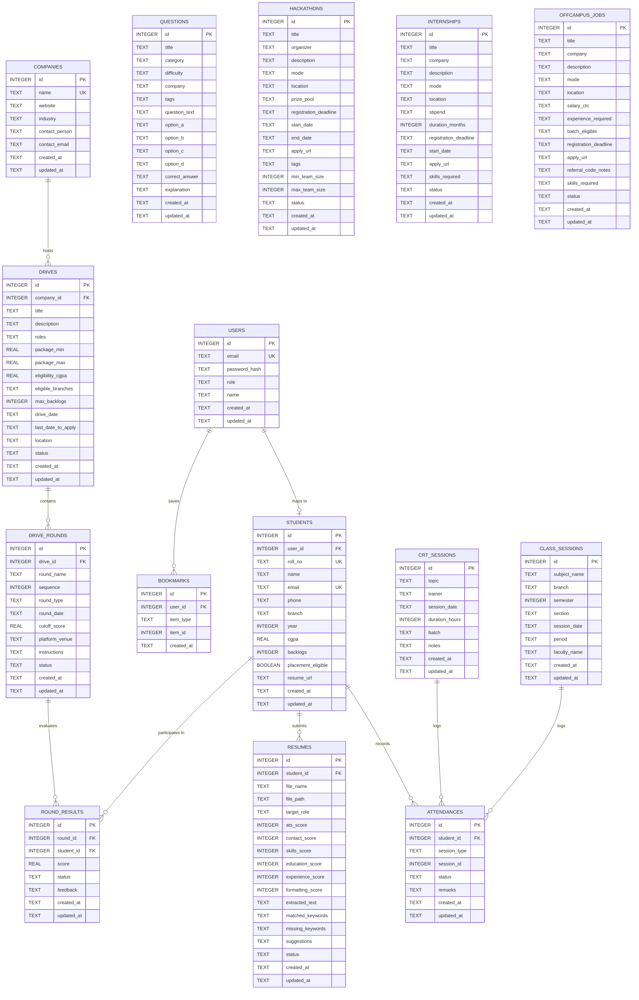

# Institute Pillar Database Schema & Architecture

The Institute pillar uses **SQLite 3** as its database engine. SQLite was selected for zero-configuration, single-file portability, high query performance, and straightforward containerization.

---

## 1. Concurrency & Connection Pooling Architecture

SQLite supports multiple concurrent readers and a single concurrent writer. To ensure ACID compliance without lock contention:

1. **HikariCP Connection Pool**: Configured with `maximum-pool-size: 1` on write operations to serialize SQLite transactions and prevent `SQLITE_BUSY` errors.
2. **Write-Ahead Logging (WAL)**: Enabled on startup via `PRAGMA journal_mode=WAL;`, allowing simultaneous reads while a write transaction is executing.
3. **Foreign Key Enforcement**: Explicitly activated via `PRAGMA foreign_keys = ON;` upon connection establishment.
4. **Dates and Timestamps**: Stored consistently as ISO-8601 strings (`YYYY-MM-DDTHH:MM:SSZ`).

---

## 2. Entity-Relationship (ER) Diagram

