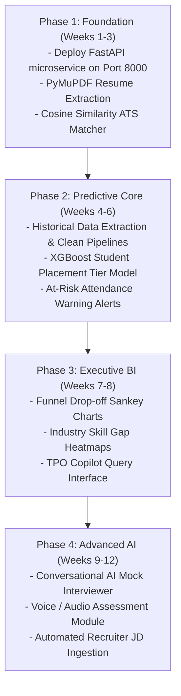

# Placement Assistance Platform — AI, Data Science & Predictive Analytics Scaling Roadmap

---

## 1. Executive Vision & Objectives

This document provides a technical specification and blueprint for scaling the **Placement Assistance Platform** into an intelligent, data-driven career secretariat. By integrating **Machine Learning (ML)**, **Natural Language Processing (NLP)**, and **Large Language Models (LLMs)**, the platform shifts from a reactive administrative portal to a proactive intelligence engine that maximizes student placement conversion, optimizes corporate recruitment velocity, and provides actionable curriculum insights for university leadership.

---

## 2. Target Architectural Topology

To maintain the rock-solid stability of the existing Java Spring Boot pillars (`portal`, `institute`, `placement`), AI and Data Science workloads should be introduced via an **asynchronous intelligence service layer**:

```
[ FRONTEND CLIENTS (HTML5 / Vanilla JS) ]
                   │
                   │ Standard HTTPS REST
                   ▼
┌────────────────────────────────────────────────────────┐
│           PORTAL GATEWAY / BACKEND CLUSTER             │
│            (Spring Boot 3.3.4 / Java 17)               │
│                                                        │
│  - Application Workflows & Relational State (JPA)      │
│  - Role-Based Security & JWT Token Verification        │
│  - Document Storage (/data/.../uploads/)               │
└──────────────────────────┬─────────────────────────────┘
                           │
             REST API Calls / HTTP Webhooks
                           │
                           ▼
┌────────────────────────────────────────────────────────┐
│            AI & DATA SCIENCE MICROSERVICE              │
│            (Python 3.11+ / FastAPI on Port 8000)       │
│                                                        │
│  ┌─────────────────────────┐  ┌─────────────────────┐  │
│  │   NLP & RESUME ENGINE   │  │ PREDICTIVE ML CORE  │  │
│  │  - PyMuPDF / pdfplumber │  │  - scikit-learn     │  │
│  │  - Sentence Transformers│  │  - XGBoost          │  │
│  │  - LangChain / Gemini   │  │  - pandas / numpy   │  │
│  └─────────────────────────┘  └─────────────────────┘  │
│  ┌─────────────────────────┐  ┌─────────────────────┐  │
│  │  AI INTERVIEW ENGINE    │  │ EXECUTIVE BI ENGINE │  │
│  │  - Prompt Orchestrator  │  │  - Drop-off Funnel  │  │
│  │  - Code Rubric Evaluator│  │  - Skill Gap Matrix │  │
│  └─────────────────────────┘  └─────────────────────┘  │
└────────────────────────────────────────────────────────┘
```

### Why a Dedicated Python FastAPI Microservice?
1. **Ecosystem Superiority:** Python is the industry standard for ML/AI (PyTorch, scikit-learn, XGBoost, LangChain, Hugging Face).
2. **Zero Blast Radius:** Heavy ML vector computation or LLM API latencies will never block Java Spring Boot thread pools or delay student attendance logging.
3. **Decoupled Scaling:** The AI service can be scaled independently (or deployed on a GPU-enabled instance) while Spring Boot runs on standard CPU containers.

---

## 3. High-Priority AI & Data Science Feature Modules

### Feature 01: AI Resume-to-JD Match & ATS Scoring Engine

#### Problem Solved
Students apply to campus drives with generic, unoptimized resumes that fail company ATS screening algorithms. TPOs lack the bandwidth to manually review thousands of student CVs.

#### Technical Implementation
1. **Document Ingestion:** Candidate PDF/DOCX resumes stored in `data/institute/uploads/resumes/` are parsed using `PyMuPDF` or `pdfplumber` into structured text sections (Experience, Projects, Skills, Education).
2. **Semantic Vector Embedding:**
   - The parsed resume text and the target Drive's Job Description (JD) are converted into dense vector embeddings using `sentence-transformers/all-MiniLM-L6-v2` or Google Gemini Embedding API (`text-embedding-004`).
3. **Similarity Calculation:**
   $$\text{Cosine Similarity} = \frac{\mathbf{u} \cdot \mathbf{v}}{\|\mathbf{u}\| \|\mathbf{v}\|}$$
4. **LLM Gap & STAR Analysis:**
   - An LLM prompt evaluates the delta between the resume and the JD.
   - Outputs:
     - **ATS Match Score (0–100%)**
     - **Missing Critical Keywords** (e.g., Docker, Kafka, JUnit)
     - **STAR Method Optimization Suggestions** for existing bullet points.

#### API Contract
```json
POST /api/ai/resume/analyze
Request:
{
  "studentRollNo": "22CS084",
  "resumeFileUrl": "/uploads/resumes/22CS084_resume.pdf",
  "driveId": 5,
  "jobDescriptionText": "Seeking Software Engineer with experience in Spring Boot, REST APIs, and PostgreSQL..."
}

Response:
{
  "overallMatchScore": 78,
  "atsScore": 84,
  "missingKeywords": ["PostgreSQL", "Docker", "Unit Testing"],
  "matchedSkills": ["Spring Boot", "REST APIs", "Java", "Git"],
  "recommendations": [
    "Highlight your database indexing experience from your e-commerce project.",
    "Add measurable metrics to Project 2 (e.g., 'reduced API latency by 35%')."
  ]
}
```

---

### Feature 02: Automated Drive Ingestion & Unstructured JD Parser

#### Problem Solved
Placement Officers manually copy-paste recruitment criteria, branches, cutoffs, and package tiers from lengthy recruiter emails or unstructured PDF brochures into the drive registration form.

#### Technical Implementation
1. TPO uploads a raw PDF or pastes the recruiter's email in the **Register Master Drive** modal.
2. The text is passed to an LLM with a strict JSON schema enforcement prompt:
   - Extract `companyName`, `jobRole`, `baseSalary`, `totalCtc`, `minCgpa`, `maxBacklogs`, `eligibleBranches`, `hiringRounds`, and `registrationDeadline`.
3. The extracted JSON directly pre-populates the frontend form fields for instant human review and confirmation.

---

### Feature 03: Student Placement Tier Probability Predictor (Supervised ML)

#### Problem Solved
Institutes cannot predict which students are at risk of being unplaced or which students are prime candidates for Tier-1 Super Dream packages ($> 20\text{ LPA}$), resulting in generic, untargeted preparation.

#### Machine Learning Architecture
* **Model Type:** Multi-Class Gradient Boosted Decision Trees (`XGBoostClassifier` / `LightGBM`).
* **Target Variable:** Placement Outcome Class:
  - `0`: Unplaced / At Risk
  - `1`: Standard Tier ($4\text{--}8\text{ LPA}$)
  - `2`: Dream Tier ($8\text{--}18\text{ LPA}$)
  - `3`: Super Dream Tier ($> 18\text{ LPA}$)

#### Input Feature Matrix ($\mathbf{X}$)
| Feature Name | Type | Source Module |
| :--- | :--- | :--- |
| `cgpa` | Float | Institute / Student Dossier |
| `class_attendance_pct` | Float | Institute / Attendance Module |
| `crt_training_attendance_pct`| Float | Institute / CRT Sessions |
| `active_backlogs_count` | Integer | Institute / Academic Registry |
| `history_of_arrears` | Binary | Institute / Academic Registry |
| `solved_problems_count` | Integer | Institute / Question Bank Practice |
| `mock_test_avg_score` | Float | Institute / Practice Arena |
| `hackathons_participated` | Integer | Institute / Hackathon Tracker |
| `internships_completed` | Integer | Institute / Internship Records |
| `ats_resume_avg_score` | Float | AI Resume Analyzer |

#### Model Training & Inference Workflow
1. Historical batch data (2023, 2024, 2025) is exported to train the initial baseline model using cross-validation.
2. Inference is executed periodically (e.g., weekly) or on-demand when a mentor views a student dossier.
3. Outputs are displayed as a visual probability badge on the **Student Profile** page.

---

### Feature 04: "At-Risk" Early Warning & Attendance Anomaly Detection

#### Problem Solved
Students often fall below the mandatory 75% attendance threshold or fail successive Aptitude tests silently without timely intervention by academic counselors.

#### Technical Implementation
* **Algorithm:** Time-series decay analysis + Threshold rule monitoring.
* **Logic:** Computes attendance trajectory:
  $$\text{Projected Final Attendance} = \frac{\text{Attended Sessions} + \text{Remaining Sessions}}{\text{Total Academic Sessions}}$$
* If the projected percentage cannot mathematically reach $75\%$ without $100\%$ perfect attendance for the remainder of the semester, the system triggers an **Urgent Academic Compliance Alert** in `portal.db` and emails the student's assigned faculty mentor.

---

### Feature 05: Recruitment Funnel Drop-off & Conversion Analytics (Executive BI)

#### Problem Solved
College Directors and Deans cannot pinpoint *why* students are getting rejected during drives (e.g., Is it aptitude? Coding assessments? Technical interviews? Communication?).

#### Technical Implementation
1. An aggregation pipeline calculates stage conversion ratios across drives and branches:
   $$\text{OA Pass Rate} = \frac{\text{Cleared OA}}{\text{Appeared OA}}, \quad \text{Tech Pass Rate} = \frac{\text{Cleared Tech}}{\text{Appeared Tech}}$$
2. **Visual Funnel / Sankey Representation:**
   Renders an interactive funnel diagram on the Director's Dashboard displaying:
   $$\text{1000 Applied} \xrightarrow{82\%} \text{820 Shortlisted} \xrightarrow{45\%} \text{369 OA Cleared} \xrightarrow{28\%} \text{103 Tech 1 Cleared} \xrightarrow{65\%} \text{67 Offers}$$
3. **Data-Driven Prescriptions:** If the drop-off is steepest in *Tech Round 1*, the dashboard flags:
   > *"Actionable Insight: 72% drop-off detected in Technical Round 1 for Core Engineering students. Recommend organizing dedicated System Design & DSA interview bootcamps."*

---

### Feature 06: AI Mock Interviewer & Dynamic DSA Coach

#### Problem Solved
Hiring external mock interviewers is costly and difficult to schedule at scale for thousands of final-year candidates.

#### Technical Implementation
1. Leverages the existing **Question Bank** (`institute.db`) containing categorized DSA and behavioral problems.
2. The AI mock engine presents a coding problem, evaluates candidate solution code (syntax, edge-case coverage, algorithmic complexity $\mathcal{O}(N)$), and conducts an interactive conversational code review.
3. Scores candidate on 4 dimensions:
   - Problem Comprehension & Clarifying Questions (1–5)
   - Code Correctness & Efficiency (1–5)
   - Edge Case Handling (1–5)
   - Communication & Explanation (1–5)

---

## 4. Phase-by-Phase Implementation Roadmap



---

## 5. Deployment & Infrastructure Strategy for AI Services

To keep cloud hosting costs minimal while maximizing performance:
1. **Hosting:** Deploy the Python FastAPI microservice as a separate lightweight container on **Railway** alongside the unified Java Portal container.
2. **Private Networking:** Connect Spring Boot to FastAPI using Railway's internal private network (`http://ai-service.railway.internal:8000`), ensuring zero latency egress fees and high security.
3. **LLM Inference:** Use the **Gemini 1.5 Flash API** for document extraction and semantic feedback due to its industry-leading token pricing, massive context window (1M tokens for bulk resume ingestion), and sub-second response times.

